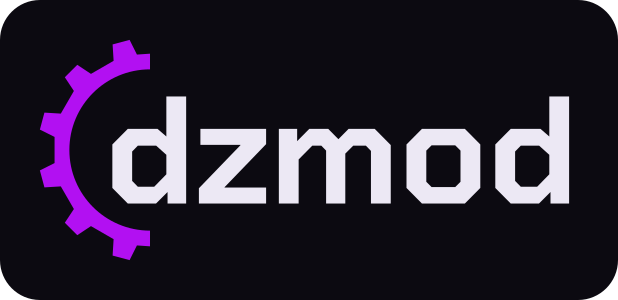

<p align="center">
  
</p>

<p align="center">Install, update and remove DayZ Workshop mods on a Linux dedicated server via SteamCMD.</p>

<p align="center">
  
  
  
  
</p>

## Installation

```sh
curl -LsSf https://raw.githubusercontent.com/KarnesTH/dzmod/main/install.sh | sh
```

From a local checkout:

```sh
uv tool install .
```

## Requirements

- Linux and [uv](https://docs.astral.sh/uv/) (uv provides Python 3.14 if needed)
- A Steam account that owns DayZ
- SteamCMD — installed into `~/Steam` by dzmod if missing; 32-bit libraries have to be installed by you (dzmod shows the
  command)
- Optional: SteamID64 and a [Steam Web API key](https://steamcommunity.com/dev/apikey) to list your subscribed mods

## Usage

Run the server commands inside the DayZ server directory or pass `--server-dir`.

| Command                          | Description                                                                |
|----------------------------------|----------------------------------------------------------------------------|
| `dzmod setup`                    | Set Steam login, SteamID64 and API key (runs automatically on first start) |
| `dzmod mods [-r]`                | Show your subscribed DayZ mods; `-r` fetches them from Steam again         |
| `dzmod check`                    | Show the update state of all installed mods                                |
| `dzmod update`                   | Download outdated mods and install them again                              |
| `dzmod install`                  | Pick mods from your subscriptions                                          |
| `dzmod install --mod-id <ID …>`  | Install mods by Workshop ID                                                |
| `dzmod install --collection`     | Install the mods of `dzmod.col`                                            |
| `dzmod remove [--mod-id <ID …>]` | Remove mods, their keys and CE entries                                     |

What `install` does:

- Copies the mod into the server directory and missing `.bikey` files into `keys/`
- Extracts `types`, `spawnabletypes` and `events` from the mod into `mpmissions/<mission>/ce_<mod_name>/` and registers
  them in `cfgeconomycore.xml`
- Map mods are set up first: mission files are fetched, copied to `mpmissions/` and set as `template` in `serverDZ.cfg`
- Expansion mods add `expansion_ce` and the event spawns from the official Expansion mission templates
- Prints the `-mod=` start parameter

## Collection

`dzmod.col` in the server directory:

```
[collection]
name = "My Server"
description = "Mods used on my server"
created = 2026-11-15
updated = 2026-11-15

[mods]
CF
Community-Online-Tools
MMG Base Storage
```

Mods are listed by their Workshop title. The order is used for `-mod=` after CF, COT and Dabs Framework.

## Files

| Path                             | Content                                                |
|----------------------------------|--------------------------------------------------------|
| `~/.config/dzmod/.env`           | Steam login, SteamID64, API key (permissions `600`)    |
| `~/.local/share/dzmod/mods.json` | Your subscribed mods as returned by Steam              |
| `~/.cache/dzmod/repos/`          | Downloaded mission and Expansion template repositories |

## Development

```sh
uv sync
uv run pytest
```